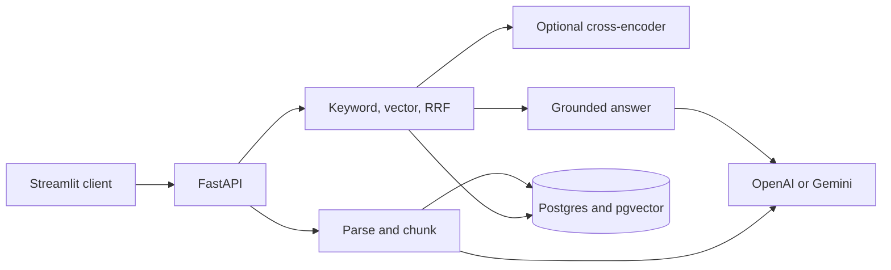

# Architecture

Atlas is one process that serves HTTP, plus a Streamlit process that is only an HTTP client. Postgres stores documents, chunks, a `vector(1536)` column, and a stored English `tsvector`. Ranking is not done in the route handlers.

## Modules

- `config` reads the environment. A blank key is unset. Whitespace in a key is invalid. The error does not include the value.
- `database` creates an engine only when a session or `/ready` asks for one. `postgresql://` is rewritten to the psycopg v3 dialect.
- `ingestion` sniffs bytes, then cuts character windows. PDF pages are windowed separately. Markdown windows carry the nearest ATX heading.
- `embeddings` is a batch function: one vector per string, same order. The OpenAI or Gemini client is built only after the key check.
- `retrieval` runs keyword search, cosine search, reciprocal rank fusion, and the optional reranker.
- `generation` puts passages in a fenced user message, then drops citations whose chunk was not retrieved or whose quote is not in that passage.
- `evaluation` scores a versioned dataset. The faithfulness judge is not ground truth.
- `ui` calls the API with a 30 second timeout. It does not import the database.

## Provider choice

If `OPENAI_API_KEY` is set, embeddings and generation use OpenAI. The defaults are `text-embedding-3-small` and `gpt-6-luna`. If only `GEMINI_API_KEY` is set, embeddings use `gemini-embedding-001` with `output_dimensionality` 1536, and generation uses `gemini-3.5-flash-lite`.

`gemini-2.5-flash` and `gemini-2.5-flash-lite` returned HTTP 404 for new users on the key that was tried. `gemini-3.6-flash` can return JSON, and `thinking_budget` 0 is accepted, but that key's free-tier `generate_content` quota is 20 requests per day. `gemini-3.8-flash` hit HTTP 504 inside the 30 second client timeout. `gemini-3.5-flash` was not used: its card treats it as deprecated, and the two pricing pages did not agree. `gemini-3.5-flash-lite` returns JSON. `thinking_budget` 0 is HTTP 400 on that model, so the client retries the same call once without `thinking_config`.

`text-embedding-3-large` is 3072 dimensions. Startup rejects it and says a new migration is required. The column stays 1536.

## Trade-offs that are in the code

Character windows are deterministic and do not download a tokenizer. A window can split a word. The short tail is kept so the end of a page is not dropped.

Cosine distance matches the way these embedding models are compared. There is no approximate index. Search is an exact scan and gets slower as the corpus grows.

Reciprocal rank fusion keeps a rare lexical hit that cosine ranks last, and a paraphrase that shares no words. It does not train a ranker. The English snowball stemmer drops stop words and will not match most identifiers.

The cross-encoder rescores a pool of 20 and cuts back to `top_k`. It cannot recover a passage the pool never retrieved. It is off unless the request sets `rerank`, and it is absent from the default image.

The citation check is a substring test. A quote can occur in the passage and still not support the sentence. If a citation survives, the answer string is returned even when it also contains instruction text.

Upload with a provider key embeds before insert, so a bad vector never leaves a row. `scripts/ingest.py` inserts first and embeds second. If that call fails, the document remains with null embeddings and the script exits 1.

## How a failure looks

`/health` stays 200 when Postgres is down. `/ready` returns 503. Asking for a session without `DATABASE_URL` raises `AtlasConfigError` instead of a driver traceback.

Vector and hybrid search return 503 when no provider key is set, rather than an empty hit list that looks like "nothing matched." Keyword search still returns 200. Ask returns 503 in every mode when no key is set, including keyword mode, because generating an answer needs a provider. That check happens before a database connection.

If the rerank extra is not installed, `rerank: true` returns 503 and ask does not call the generator.

## What to say about one failure

Retrieved text is untrusted. A citation whose chunk id was not retrieved, or whose quote is not in that passage, is dropped. If none survive, the API abstains instead of returning the model's prose. That does not prove a live model ignored an instruction, and it does not isolate users.
